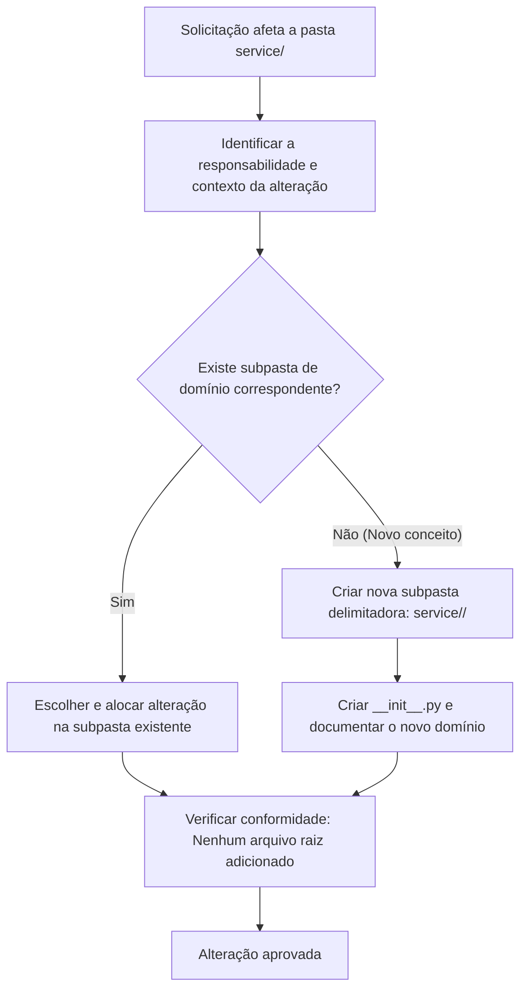

# Regras de Domínio da Camada de Serviço (`service/`)

Este documento estabelece as **regras obrigatórias de funcionamento para a Inteligência Artificial e desenvolvedores** ao manipular qualquer arquivo ou funcionalidade dentro da pasta `service/`.

---

## 1. Princípio Fundamental: Delimitação Estrita de Domínio (Bounded Contexts)

A pasta `service/` **não permite arquivos de negócio avulsos na sua raiz**. Todo e qualquer código de serviço deve obrigatoriamente residir dentro de uma **subpasta que delimite um domínio específico**.

```text
service/
├── __init__.py                  # Permitido (apenas exportações gerais)
├── README.md                    # Permitido (documentação)
├── RULES.md                     # Permitido (este documento)
│
├── <dominio_A>/                 # ✅ OBRIGATÓRIO: Subpasta delimitadora de domínio
│   ├── __init__.py
│   ├── use_case.py
│   └── domain_service.py
│
└── <dominio_B>/                 # ✅ OBRIGATÓRIO: Outra subpasta delimitadora
    ├── __init__.py
    └── ...
```

> [!CAUTION]
> **Proibição Rígida para a IA:** Nunca crie arquivos como `service/prompt_service.py`, `service/user_service.py` ou `service/helpers.py` na raiz de `service/`. Todo arquivo deve estar categorizado em uma subpasta de domínio.

---

## 2. Protocolo de Identificação de Alterações para a IA

Quando a IA receber uma solicitação que altere ou adicione código na pasta `service/`, ela deve executar o seguinte protocolo em 4 etapas:



### Etapa 1: Detecção de Escopo
- A IA deve verificar se os arquivos criados ou modificados possuem o caminho iniciado por `service/`.

### Etapa 2: Classificação Semântica
- Qual é o domínio de negócio da mudança?
  - Trata de regras de prompts e validações? -> `service/prompt_governance/`
  - Trata de auditoria e logs de execução? -> `service/audit_logging/`
  - Trata de orquestração de modelos LLM? -> `service/model_interaction/`
  - Trata de análise de métricas arquiteturais? -> `service/architecture_metrics/`

### Etapa 3: Decisão de Alocação
- Se o domínio já existir: alocar diretamente dentro da subpasta.
- Se o domínio for novo:
  1. Criar `service/<novo_dominio>/`.
  2. Incluir `service/<novo_dominio>/__init__.py`.
  3. Adicionar uma breve descrição da fronteira de domínio.

### Etapa 4: Validação Pós-Edição
- Executar a checagem para garantir que `service/` não contém arquivos `.py` novos diretamente em seu nível raiz.

---

## 3. Catálogo de Domínios Padrão

| Subpasta de Domínio | Responsabilidade | Exemplos de Conteúdo |
|---|---|---|
| `service/prompt_governance/` | Regras de negócio para validação, sanitização e scoring de prompts | `validate_prompt_use_case.py`, `rules_evaluator.py` |
| `service/audit_logging/` | Rastreabilidade, histórico de execuções e metadados de auditoria | `save_audit_log_use_case.py`, `history_query_service.py` |
| `service/model_interaction/` | Orquestração do envio de tarefas para LLMs e pós-processamento de respostas | `generate_architecture_analysis_use_case.py` |
| `service/architecture_metrics/` | Avaliação e cálculo de métricas de arquitetura de software | `calculate_coupling_service.py` |

---

## 4. Checklist Obrigatório para a IA

Antes de concluir qualquer resposta ou commit que envolva `service/`, a IA deve validar:
- [ ] O arquivo criado/alterado está em uma subpasta dentro de `service/`?
- [ ] A subpasta possui um `__init__.py`?
- [ ] O nome da subpasta reflete um substantivo ou conceito de domínio claro em `snake_case`?
- [ ] A raiz de `service/` permaneceu limpa (sem novos scripts `.py` soltos)?
